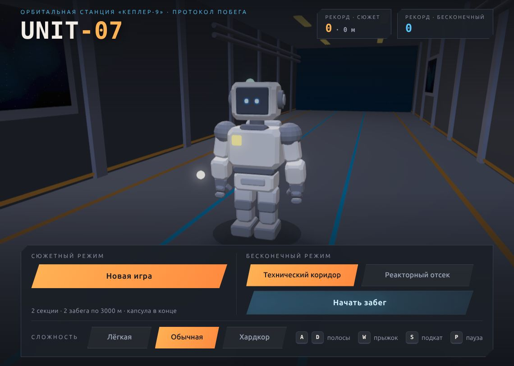

# UNIT-07 · Орбитальный забег

Браузерный раннер на BabylonJS. Сервисный бот UNIT-07 бежит по аварийной
орбитальной станции «Кеплер-9» и уклоняется от препятствий, чтобы добраться
до спасательной капсулы.

**Играть онлайн:** https://bolleks.github.io/orbit-escape/



Всё работает офлайн: BabylonJS и environment-карта лежат в репозитории,
внешних CDN и запросов нет.

## Сюжет

Станция «Кеплер-9», в реакторном отсеке авария. Экипаж эвакуирован, но
сервисный бот UNIT-07 — последний из серии — пропустил сигнал тревоги,
находясь в сервисном режиме. Активирован «Протокол побега»: беги через
секции станции к спасательной капсуле.

## Режимы

### Сюжетный

- Две секции: «Технический коридор» и «Реакторный отсек», между ними шлюз;
  в конце второй секции — капсула и финал «Эвакуация завершена».
- Секция — забег на 3000 м. После каждой секции открывается сервисный
  отсек с улучшениями (по 3 уровня):
  - **Пружины** — выше прыжок;
  - **Стабилизаторы** — длиннее подкат;
  - **Магнит** — шире захват ячеек: соседние полосы → все полосы → сбор
    на любой высоте прыжка;
  - **Бронепластина** — поглощает столкновения (по числу уровней за забег).
- Столкновение — повтор уровня с нуля; собранные ячейки и купленные
  улучшения сохраняются.
- Прогресс сохраняется в браузере: в меню есть «Продолжить» и «Новая игра».

### Бесконечный

- Выбор любой из двух секций сразу, без сервисных отсеков и улучшений.
- Ячейки дают только очки. Столкновение — конец забега.
- Рекорд хранится отдельно для каждой секции.

## Как играть

Три полосы, автоматический бег, скорость растёт с дистанцией. Три сложности.

- **Препятствия:** низкие барьеры — прыжок, верхние балки — подкат,
  глухие контейнеры — смена полосы. В реакторном отсеке есть цистерны
  с плоской крышей: на них можно запрыгнуть и бежать по крыше.
- **Ячейки:** счёт = метры + собранные ячейки × 25.
- **Бусты:** 3 случайных буста за забег (не ближе 500 м друг к другу),
  по 10 секунд: Форсаж, Магнит-3, Удвоитель, Хронодемпфер, Россыпь,
  Импульсный прыжок. Активный буст виден аурой вокруг робота в цвете
  буста, за 3 секунды до конца аура пульсирует.
- **Пауза и звук:** пауза по `P` / `Esc`, кнопка mute сверху. Звук —
  синтез через WebAudio, без аудиофайлов.

### Управление

| Действие | ПК | Смартфон |
|---|---|---|
| Смена полосы | `A` / `D`, `←` / `→` | свайп влево / вправо |
| Прыжок | `W`, `↑`, `Space` | свайп вверх |
| Подкат (в воздухе — быстрое приземление) | `S`, `↓` | свайп вниз |
| Пауза | `P`, `Esc` | кнопка сверху |
| Повтор забега | `R` | — |

## Запуск локально

Игре нужен любой статический сервер (из-за загрузки `.env` и скриптов):

```bash
python3 -m http.server 8000
```

Открыть http://localhost:8000 — корневая страница перенаправит на игру.

## Публикация

Игра размещена на GitHub Pages из ветки `main`, корень репозитория.
После пуша изменений сайт обновляется автоматически (1–2 минуты).

## Структура

| Файл | Назначение |
|---|---|
| `index.html` | входная страница, перенаправление на игру |
| `game.html` | страница игры: HUD, меню, пауза, итоги |
| `css/game.css` | интерфейс, адаптив под смартфоны |
| `js/game.js` | мир, препятствия, физика, анимация бега, звук, ввод |
| `js/game-state.js` | логика прогрессии: секции, забеги, улучшения, рекорды, сохранения |
| `js/boosts.js` | временные бусты и их эффекты |
| `js/platforms.js` | крыши цистерн и опоры |
| `js/robot.js` | сборка low-poly робота, материалы, палитры |
| `js/chamfer.js` | генератор фаскованных боксов |
| `vendor/babylon.js` | BabylonJS (локально) |
| `assets/environmentSpecular.env` | prefiltered environment для PBR |

## Технологии

- BabylonJS (WebGL) — рендер, физика и анимация.
- Чистый JavaScript и CSS, без сборки и зависимостей.
- `localStorage` — прогресс, улучшения и рекорды.
- WebAudio — звук.